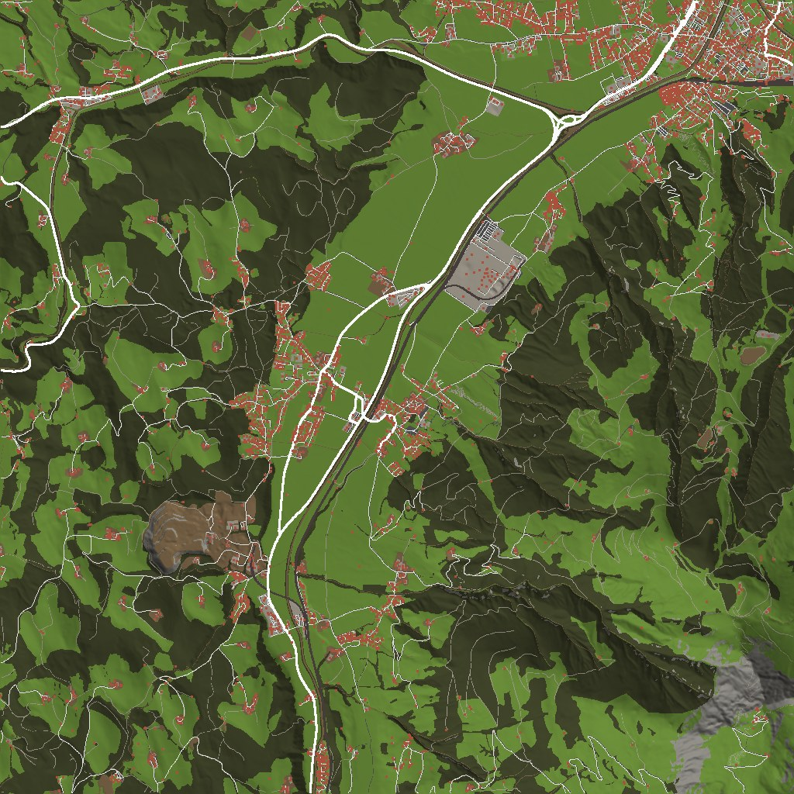

# Oberndorf in Tirol – BeamNG.drive Map

Eine Freeroam-Map von **Oberndorf in Tirol (Bezirk Kitzbühel)**, automatisch aus echten Geodaten erzeugt.
Die ganze Gemeinde (ca. 6 × 6 km) ist drin – vom Ortszentrum über die B161 und die Bahn bis hinauf auf
das Kitzbüheler Horn.



## Was ist drin

| Bereich | Inhalt |
|---|---|
| Gelände | 6,1 × 6,1 km, 1,5 m Raster, echtes Höhenmodell (Ache-Tal 655 m bis Kitzbüheler Horn 1996 m) |
| Straßen | ca. 2.500 echte Straßen und Wege (B161 Pass-Thurn-Straße, Landes- und Gemeindestraßen, Güterwege, Fuß- und Radwege) mit echten Namen, Breiten, Belag (Asphalt / Schotter / Pflaster), Einbahnen und Brücken |
| Markierungen (österr. Norm) | Leitlinien (Ortsgebiet 3/6 m, Freiland 6/12 m), Sperrlinien vor Kreuzungen, in engen Kurven und vor Bahnübergängen, Randlinien (an Einmündungen unterbrochen), Haltelinien bei STOP, Ordnungslinien, Schutzwege (Zebrastreifen), gelbe Zickzacklinien bei Bushaltestellen |
| Verkehrszeichen | Vorrang geben, STOP, Vorrangstraße, Tempolimits (an den echten Wechselstellen), Ortstafel / Ortsende („Oberndorf in Tirol", „St. Johann in Tirol"), Schutzweg-Tafeln, Haltestellen mit Namen, blaue Straßennamenschilder an Kreuzungen, Andreaskreuze an Bahnübergängen, Ampeln |
| Gebäude | ca. 5.100 Gebäude auf den echten Grundrissen: Tiroler Wohnhäuser mit Satteldach, Holz-Obergeschoss und Balkonen mit Blumenkästen, Bauernhöfe und Stadel, Gewerbe/Industrie, Kirchen mit Spitzturm, Kapellen, Garagen |
| Bahn | Salzburg-Tiroler-Bahn mit Gleis, Schotterbett, Oberleitung, Bahnsteig Oberndorf, Bahnbrücken |
| Wasser | Kitzbüheler Ache, Aschauer Ache, Bäche (Griesbach u. a.), Weiher |
| Ausstattung | Straßenlaternen, Leitpflöcke, Leitschienen an Dämmen und Brücken, Holzzäune, Mauern, Hecken, Bänke |
| Vegetation | ca. 266.000 Waldbäume (Fichten und Laubbäume) in den echten Waldflächen + ca. 2.200 einzelne Bäume im Ort |
| Spawnpunkte | Ortszentrum (Kirche), Bahnhof Oberndorf, B161, Panoramastraße Kitzbüheler Horn |
| KI-Verkehr | Alle Straßen sind für die KI befahrbar (inkl. Brücken), Einbahnen sind hinterlegt |

## Installation (am einfachsten)

1. [`Oberndorf_installieren.bat`](Oberndorf_installieren.bat) herunterladen und **doppelklicken**.
   Falls Windows warnt („Der Computer wurde durch Windows geschützt"): *Weitere Informationen → Trotzdem ausführen*.
2. Der Installer findet deinen BeamNG-Ordner, lädt die Map (ca. 80 MB) und legt sie in den Mods-Ordner.
3. BeamNG starten → *Freeroam* → **Oberndorf in Tirol**.

## Installation (von Hand)

1. `dist/oberndorf_in_tirol.zip` herunterladen (**nicht entpacken**).
2. Die ZIP-Datei in den BeamNG-Mods-Ordner kopieren. Am einfachsten: im Spiel unter
   *Mods → Ordner öffnen*. Normalerweise ist das
   `%LOCALAPPDATA%\BeamNG.drive\<Version>\mods\` (ältere Versionen: `Dokumente\BeamNG.drive\mods\`).
3. BeamNG starten → *Freeroam* → **Oberndorf in Tirol**.

**Beim ersten Laden** wandelt BeamNG die rund 680 Modelldateien (.dae) in sein eigenes Format um.
Das kann ein paar Minuten dauern – danach lädt die Map deutlich schneller.

## Wie genau ist das?

Straßenverlauf, Straßennamen, Gebäudegrundrisse, Brücken, Bahn, Gewässer, Wald, Zebrastreifen,
Bushaltestellen, Ampeln, STOP- und Vorrang-Stellen sowie Tempolimits kommen aus den echten Daten
(OpenStreetMap). Das Gelände stammt aus einem hochauflösenden Höhenmodell.

Ehrlich gesagt, was **nicht** 1:1 ist:

* **Fassaden und Dächer** sind typisch tirolerisch nachgebaut, aber nicht jedes Haus sieht exakt so aus
  wie in echt (Grundriss und Höhe stimmen, Fensteranordnung/Farbe nicht unbedingt).
* **Schilder**: alle in den Daten erfassten Schilder sind drin; fehlende (z. B. Vorrang geben an
  Einmündungen in die B161/Landesstraßen) werden nach österreichischer Praxis ergänzt. Es kann also
  hier und da ein Schild fehlen oder zusätzlich stehen.
* Google Maps / Google Earth / Street View durften nicht verwendet werden (Lizenz), daher keine Fotos
  als Texturen.
* Die Map wurde ohne laufendes BeamNG erzeugt und mit eigenen Prüfungen getestet. Falls im Spiel etwas
  nicht stimmt (z. B. der Wald fehlt), bitte melden – der Generator lässt sich schnell anpassen.

## Selbst neu erzeugen

```bash
cd beamng-oberndorf
pip install -r requirements.txt
python -m oberndorf.fetch      # Daten laden (Overture Maps + Höhenmodell), ca. 2 Minuten
python -m oberndorf.build      # Map bauen -> dist/oberndorf_in_tirol.zip, ca. 3 Minuten
python -m oberndorf.validate   # Prüft alle Dateien, Materialien, Texturen und Modelle
```

Wichtige Einstellungen stehen in `oberndorf/config.py` (Kartenmitte, Größe, Datenstand).

| Modul | Aufgabe |
|---|---|
| `fetch.py` | lädt Overture-Maps-Daten (OpenStreetMap) und Höhen-Kacheln |
| `dem.py`, `terrain.py` | Höhenmodell, Straßen/Bäche ins Gelände einschneiden, Böschungen, Bodentexturen, `.ter`-Datei |
| `roads.py` | Straßennetz, Breiten, Beläge, Höhenverlauf, Kreuzungen, Bahnübergänge |
| `markings.py` | Fahrbahn-Decals und Bodenmarkierungen, Vorrang-Analyse an Kreuzungen |
| `props.py` | Verkehrszeichen, Laternen, Ampeln, Leitpflöcke, Leitschienen, Zäune, Bahn, Brücken |
| `buildings.py` | 3D-Gebäude aus den Grundrissen |
| `trees.py` | Wald und Einzelbäume |
| `textures.py` | alle Texturen inkl. österreichischer Verkehrszeichen |
| `level.py`, `build.py` | BeamNG-Leveldateien und Gesamtablauf |

## Quellen und Lizenzen

* Karte: © OpenStreetMap-Mitwirkende, [ODbL](https://opendatacommons.org/licenses/odbl/), bezogen über
  [Overture Maps](https://overturemaps.org/) (Release 2026-09-23).
* Höhen: Mapzen / AWS Terrain Tiles (enthält u. a. das österreichische Geländemodell von data.gv.at,
  CC BY 4.0).
